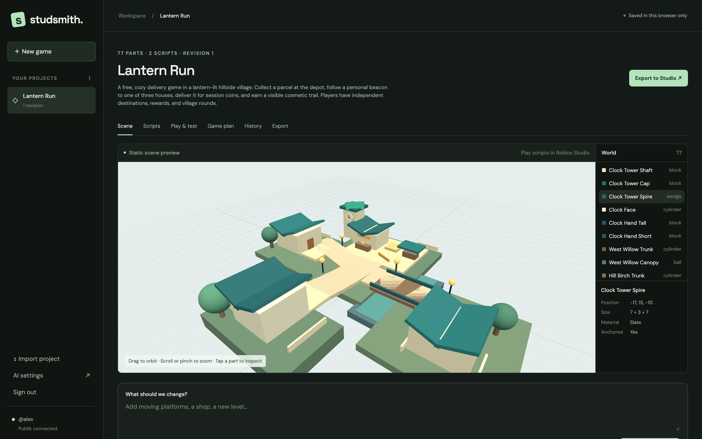
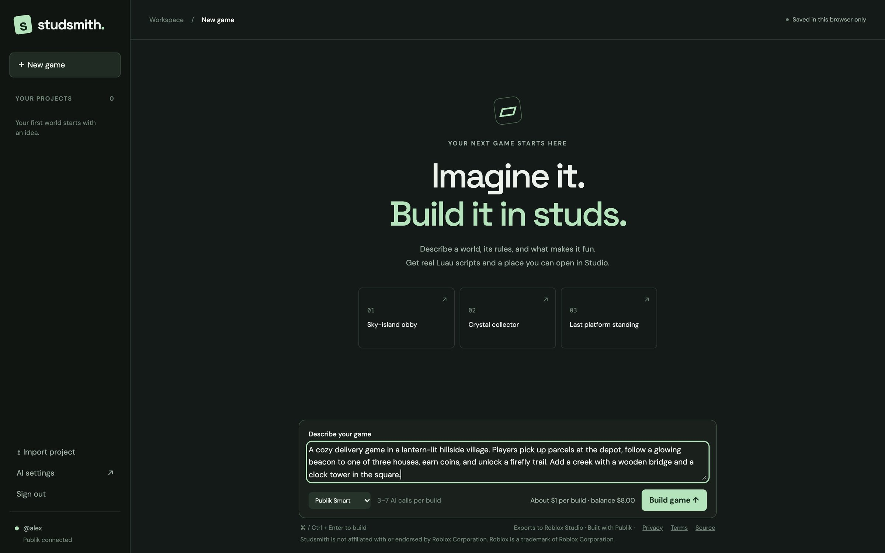
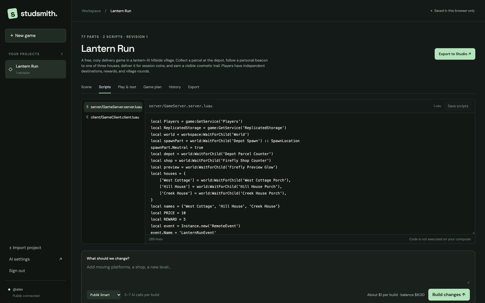
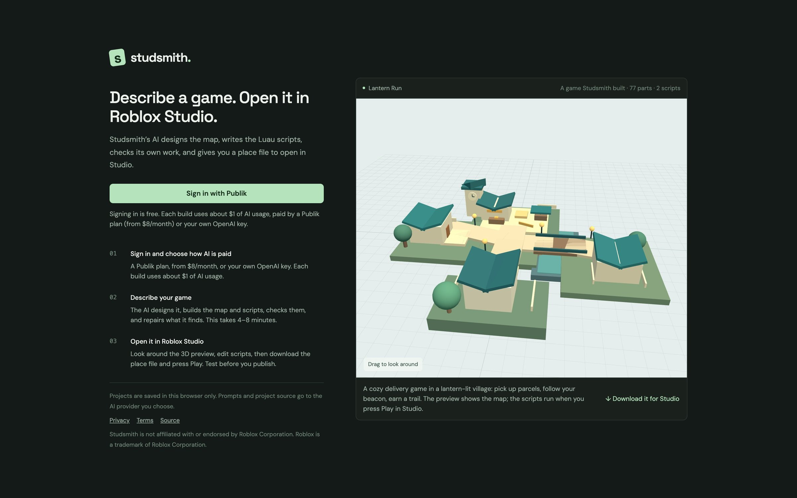
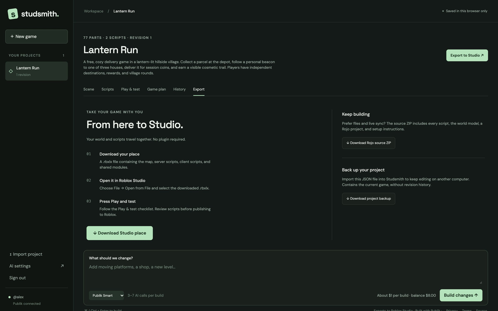

# Studsmith

Describe a Roblox game, refine its world and Luau scripts, and export a place that opens directly in Roblox Studio.



Studsmith is not affiliated with or endorsed by Roblox Corporation. Roblox is a trademark of Roblox Corporation.

Studsmith is an open-source browser app built with Publik. Try the [hosted builder](https://studsmith-theta.vercel.app). The [Publik listing](https://publikhq.com/studsmith) has an **Open directly** button to the hosted app. Source: [jibberswrld/studsmith](https://github.com/jibberswrld/studsmith).

## Build a game

1. Sign in with Publik and connect your plan, or choose your own compatible provider. A build uses about $1 of AI usage (observed $0.45–$1.60 on `publik-smart`), so the $0.05 of free use on a new Publik account is not enough; the gate says so and offers a plan or your own OpenAI key instead.
2. Describe the game. The AI designs it, builds the map and scripts, reviews the result, and repairs major findings before saving. Progress streams stage by stage; a build usually takes 4–8 minutes. Keep the tab open: leaving or reloading stops the build, and AI usage already spent is not refunded.

   

3. Inspect the scene, edit scripts, and read the Game plan and Play & test notes.

   

4. Download the Studio place. In Roblox Studio choose **File → Open from File**, select the `.rbxlx`, then press **Play**.

Before sign-in, the gate shows Lantern Run (`src/lib/examples/lantern-run.json`), a real 77-part game Studsmith generated, in the same 3D preview, and lets anyone download it as a Studio place.



If a build fails after producing a valid game (the AI check still has major findings after the last repair, the time budget runs out, or the provider returns an error such as a 402), Studsmith saves that last valid game as a draft labelled **Needs review — failed AI check**, with the reviewer's findings in Build notes, instead of discarding work the visitor paid for.

The browser shows static geometry. It does not run Roblox physics or Luau. AI review is a static check, not a playtest or a guarantee of gameplay quality or earnings.

## Design skills

Three project-owned skills are loaded into every design, build, review, and repair request. The model applies them to the actual idea; there is no genre keyword router.

- [Gameplay](skills/roblox-game-design/SKILL.md): audience, hook, core loop, onboarding, progression, replay, and mobile/social play.
- [Worldcraft](skills/roblox-worldcraft/SKILL.md): authored environments, recognizable landmarks, primitive-based architecture, traversal, readable hazards, and performance.
- [Economy and growth](skills/roblox-economy-growth/SKILL.md): currencies, retention, offers with clear player value, pricing and receipt requirements, discovery experiments, and defined metrics.

The **Game plan** records audience, hook, retention, proposed offers, their free alternatives and setup requirements, metrics, and launch experiments. It travels with the JSON backup and source ZIP. Paid offers are proposals; the offline export never invents product IDs or activates real purchases. Every build uses 3–7 AI calls and the selected provider's balance.

## Storage and privacy

Projects, saved revisions, and unsaved script recovery stay in this browser. Workspaces are separated by the signed-in Publik account. Clearing site data removes those local copies. After the first save Studsmith calls `navigator.storage.persist()` and shows a dismissible reminder to download a backup. Download a JSON backup to move a project to another browser or device; automatic cloud sync is not included.

Visitor-facing [privacy](src/app/privacy/page.tsx) and [terms](src/app/terms/page.tsx) pages live at `/privacy` and `/terms`. Keep them accurate when you change what the code sends or stores.

Each visitor gets a separate Publik install, created only when they click **Sign in** (opening the gate creates nothing), and encrypted, HttpOnly, SameSite session cookie. Install keys and own-provider keys are not exposed to JavaScript or stored in a shared server credential file. The server is stateless: only generation and account checks run there. Requests check the exact configured or platform-owned origin, and every AI request verifies the visitor's claimed Publik install.

Prompts and current project source go to the selected AI provider. Publik receives usage events without project content. Operators can set `DO_NOT_TRACK=1` or `PUBLIK_TELEMETRY=off` on the server to disable usage telemetry. A 402 shows the provider's message and its single top-up link. Publik builds are refused before any AI call when the wallet balance (which includes plan money left this month) is under the $1 estimate.

The hosted own-key option supports `https://api.openai.com/v1`. Source installs can use other OpenAI-compatible HTTPS providers or a provider on loopback. Hosted requests cannot proxy to arbitrary internal destinations, and provider redirects are rejected.

## Exports



- **Studio place**: the map and scripts in one `.rbxlx`, no plugin required.
- **Rojo source ZIP**: the place, `world.rbxmx`, `default.project.json`, `src/`, game instructions, and `studsmith.json`.
- **JSON backup**: the current game and commercial plan, without revision history. Import it to continue elsewhere.

The hierarchy is the same in both Studio and Rojo exports:

```text
Workspace.World
ServerScriptService.Server
StarterPlayer.StarterPlayerScripts.Client
ReplicatedStorage.Shared
```

With [Rojo](https://rojo.space/docs/v7/) installed, unzip the source bundle and run:

```sh
rojo build default.project.json -o game.rbxlx
rojo serve
```

Live sync needs the Rojo Studio plugin. Opening the native place does not.

## Run from source

Requires Node.js 22+ and pnpm.

```sh
pnpm install
pnpm build
pnpm start
```

Open **http://127.0.0.1:3018**. Development: `pnpm dev`.

The public, app-scoped `publik-app-token.txt` is intentionally distributed with the source. Never copy private install keys or another app's credentials into this repo. `PUBLIK_APP_TOKEN` can override the public token. `publik-balanced` and `publik-smart` are the only generation models sent to Publik.

Set a private `STUDSMITH_SESSION_SECRET` of at least 32 random characters for stable sessions. Without one, a local source run uses an ephemeral process key and visitors must reconnect after restart. Hosted Vercel deployments require the secret and use Secure cookies. Vercel's exact deployment, branch, and production domains are recognized from system environment variables. `STUDSMITH_APP_ORIGIN` adds a comma-separated list of exact origins (no paths or wildcards), for example `https://studsmith-jibberswrlds-projects.vercel.app,https://your-domain.example`; set it for extra Vercel aliases or another hosting provider.

Next.js output tracing includes the design skills and public app token. No database is required. The app must never use one shared Publik install or a server-global AI choice for all visitors.

## Verify

```sh
pnpm lint
pnpm typecheck
pnpm test
pnpm build
pnpm test:integration
```

CI (`.github/workflows/ci.yml`) runs all five on pull requests and pushes to `main`.

The tests cover no Publik install before Sign in, the low-balance gate and pre-flight 402, auth before body parsing, streamed stage events, drafts after late failures and deadline reserve, the origin allow-list, the committed example, browser workspace isolation, revision conflicts, XML/ZIP safety, Rojo builds when installed, separate encrypted visitor sessions, sign-in/plan gates, model stages and skill loading, repair/rejection, 402s, tampered cookies, cross-origin requests, telemetry, and the built-app self-test. The fixture does not make live paid AI calls or prove generated-game quality.

`PUBLIK_SELF_TEST=1 pnpm start` prints `publik self-test: ok studsmith 0.1.0` only after the built app provisions an app-scoped install and receives a valid wallet response. This uses Publik's standard credential file only for that command. A wallet self-test is not an AI generation test.

## Generation stream

`POST /api/generate` checks the session before reading the body. Auth, body, and balance errors return JSON with an HTTP status. Once a build starts the response is newline-delimited JSON (`application/x-ndjson`): `stage` events (`design`, `build`, `review`, `repair`, each `started`/`finished` with an attempt number), a `ping` every 15 seconds, then exactly one `result` (`{ game, draft }`, where `draft` is null or `{ reason, findings, topUpUrl }`) or `error` line. All AI calls share a 480-second budget inside the route's 540-second `maxDuration`; another repair starts only if a repair and its review, timed from this run, can still finish. While a build runs the browser warns before leaving and requests a screen wake lock where supported. When the visitor disconnects, the stream's `cancel()` aborts the remaining AI stages; on Vercel, `vercel.json` also opts this route into [request cancellation](https://vercel.com/docs/functions/functions-api-reference#cancel-requests) (`supportsCancellation`) so `request.signal` fires and the function ends. The browser stops reading at the final `result`/`error` line, so a reset after it can't lose the game. Draft status is stored per revision (`needsReview`), survives script saves and restores, and clears only when a build passes the AI check.

For manual fixture testing, run `pnpm mock:publik` and start the app in another terminal with:

```sh
PUBLIK_ORIGIN=http://127.0.0.1:4556 \
PUBLIK_APP_TOKEN=pat_studsmith_test \
STUDSMITH_SESSION_SECRET=local-fixture-session-secret-not-for-hosting \
pnpm start
```

The fixture logs every request it receives (`fixture: POST /api/v1/installs`) and exposes them at `GET /mock/state`. Its claimed wallet starts at $0.05 with no plan, like a new Publik account; opening its top-up link (`/wallet`) adds an $8 test plan, and `POST /mock/wallet {"balance_micros":…,"kind":"plan"}` sets any balance. `POST /mock/mode {"mode":…,"delayMs":…}` selects `ok`, `402`, `402-<stage>`, `length-<stage>`, `invalid`, `repair`, `repair-twice`, or `reject`, and slows every AI stage by `delayMs`. `STUDSMITH_GENERATION_BUDGET_MS` shortens the generation budget for tests (it can never exceed 480 seconds).

The fixture workspace is explicitly labeled. Its deterministic Cloudstep project exists only for testing, not as a user-facing demonstration of AI output.

## Scope

Initial worlds support up to 500 primitive parts. Luau can create additional gameplay, UI, and procedural objects at runtime. Arbitrary generated projects require Studio playtesting. Marketplace asset imports, live purchases, persistent online progress, automatic game publishing, and a direct Studio plugin bridge are not included.

MIT license. References: [Publik module](https://publikhq.com/sdk/publik.ts.md), [Rojo format](https://rojo.space/docs/v7/project-format/), [rbx-dom XML format](https://github.com/rojo-rbx/rbx-dom/blob/master/docs/xml.md).
